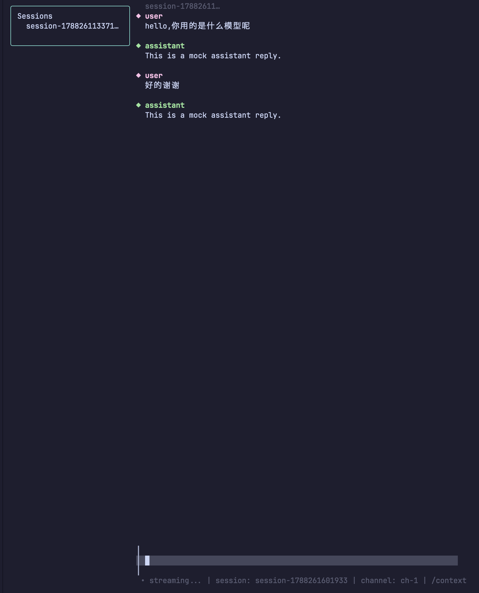

# ⚡ AgentForge

> A terminal AI development agent: understand projects, execute tasks, review diffs, and roll back safely.

[中文](README.md) | [English](README.en.md)


## ✨ Highlights

- 🤖 **Agent main flow**: natural language → plan → execute → diff → test → commit/rollback
- 🖥️ **Terminal TUI**: high-performance Bubble Tea rendering, multi-session / split view / command palette
- 🔌 **MCP ecosystem**: MCP client + permission center
- 🧠 **Repo Mode**: truly understand your project
- 🔐 **Security first**: encrypted sessions, keychain, audit, redaction
- ⚡ **Multi-agent**: parallel execution + dependency tree visualization

## 📸 Screenshot



## 🚀 Quickstart

```bash
# Check the environment
agentforge doctor

# Generate a config file
agentforge init --provider deepseek --model deepseek-chat

# Show effective config (secrets masked)
agentforge config

# Try the TUI without a backend
agentforge --mock
```

## 🖥️ Desktop GUI (Preview)

> The desktop GUI is a Flutter macOS desktop client (first target platform) for interacting with AgentForge visually.

- Start the local daemon: `agentforge serve`
- Run the GUI: `cd gui && flutter run -d macos`, or build with `make gui-macos`
- Currently includes: Agent run panel, memory browsing, timeline/session browsing, and connection status
- Future targets: Windows / Linux / mobile

## Documentation

- Quickstart (no experience needed): [docs/QUICKSTART.en.md](docs/QUICKSTART.en.md)
- Overview: [docs/overview.md](docs/overview.md)
- Full usage guide: [docs/usage.md](docs/usage.md)
- Architecture: [docs/architecture.md](docs/architecture.md)
- Changelog: [CHANGELOG.md](CHANGELOG.md)

> Note: Most in-depth docs are currently in Chinese. English readers can use this README as the main entry and refer to the linked docs as needed.

## Design Goals

- Connect to DSH through the `tui.dsh/v1alpha1` Channel protocol instead of reimplementing the Agent Harness.
- Balance performance and maintainability: a single Go binary, low memory usage, and high rendering performance.
- Implemented: real DSH Web API / Channel access, streaming chat, multi-session workspace, Context/Cost/Diff/Todo panels, provider direct connections, i18n, security, telemetry, and update checks.
- Current focus: Agent main workflow, Repo Mode, natural-language execution, Patch-to-PR, Checkpoint timeline, MCP permission center, offline queue, and project memory.
- Paused priority: enterprise suite, plugin marketplace governance, team collaboration, and MCP Server. Existing code is kept but not extended.

## Project Structure

```text
cmd/agentforge/      Entry point
internal/dshapi/     Real DSH Web API client and backend adapter
internal/client/     DSH Channel WebSocket client
internal/session/    Session state, persistence, import/export/sync
internal/share/      Session share links (AES-GCM encrypted / plaintext)
internal/skill/      Skill local install, repo clone, remote manifest sync
internal/provider/   Direct model providers: OpenAI-compatible client, proxy, routing/failover, pricing, context windows
internal/secret/     API key secure storage: system keychain / local AES-GCM encrypted file
internal/offline/    Local JSON offline message queue
internal/security/   AES-GCM encryption, redaction, audit logging
internal/plugin/     Plugin marketplace/signature/permissions/sandbox
internal/cost/       Cost estimation and budget management
internal/ui/         Bubble Tea UI
internal/i18n/       Lightweight i18n language packs (zh / en)
internal/config/     Config and CLI flags
internal/telemetry/  Optional local telemetry (JSON Lines, redacted, no network)
internal/update/     Automatic update checks (version compare + GitHub Release query)
```

## Current Features

The runnable v0.3.0 feature set can connect to the real DSH Web API:

- **DSH client and real API**: `internal/dshapi` connects to DSH Web API (HTTP RPC + WebSocket event stream) with seq resume, auto-reconnect, and real session recovery; `internal/client` keeps the Channel WebSocket client.
- **TUI workspace**: Bubble Tea chat interface, streaming rendering with virtual scrolling/incremental rendering, command palette, multiline input, multi-session tabs/split views, Context/Cost/Diff/Todo/Tools/Skills/Plugin panels, session search, full-text history search, and the `/exec` panel.
- **Provider direct connection**: `internal/provider` provides an OpenAI-compatible client, multiple API key rotation, routing/failover, error mapping, cost tables, and a model context window registry; supports HTTP/HTTPS/SOCKS5 proxies and a local offline queue.
- **P0 foundation + UI integration**: `internal/agent` (agent execution/approval state machine), `internal/contextx` (context windowing, summarization, Checkpoint/Rewind), `internal/mcp` (MCP client), and `internal/persist` / `session.AsyncStore` (async persistence); integrated into the UI via agent approval panels, `/checkpoint`, `/rewind`, `/mcp`, and `/mcp-call`.
- **P1 foundation and ecosystem**: `internal/orchestrator` multi-agent orchestration, `internal/memory` project memory/semantic search, `internal/mcpserver` MCP server basics, `internal/collab` collaboration/replay, `internal/executor` local/Docker/SSH execution, and `internal/plugin` governance (signature, permissions, sandbox, moderation).
- **P2 enterprise and automation**: `internal/enterprise` RBAC/SSO/KMS/SIEM, `internal/automation` + `cmd/agentforge-automation` scheduling, `internal/api` + `cmd/agentforge-api` REST/Webhook API, `--headless --prompt`, and `exec` CLI with `/exec` UI panel.
- **i18n**: Chinese/English UI, switch with `--lang zh|en`, default Chinese.
- **Local security**: AES-GCM encryption/decryption, sensitive data redaction, audit logs, and API key storage in system keychain or local encrypted files.
- **Telemetry and updates**: optional local telemetry (JSON Lines, redacted, no network, off by default); automatic update checks (version compare + GitHub Release query, prompt only, no auto-download).
- **Session migration**: `export` / `import` / `sync` / `sync-remote`, local batch migration, bidirectional sync, optional AES-GCM encrypted remote sync; `share` / `open` package a single session as a shareable link and import it.
- **Release and installation**: multi-platform `make release`, `make package` producing DMG/tar.gz/zip packages, Windows `scripts/install.ps1`, GitHub Actions CI, and fuzzing.

UI details:

- Commands declared by loaded plugin `Manifest.Commands` are registered in the command palette (`/plugin:<plugin>:<command>`, or `/<command>` when there is no conflict).
- Mouse support is enabled via Bubble Tea `WithMouseCellMotion`: the wheel scrolls the chat viewport and list panels (command palette, Diff, Search, Plugins, Skills, etc.).
- Help panel: press `?` (when the input box is empty) or `Ctrl+/` to open it; press `Esc` to close it. `/help` now opens this help panel instead of only setting a status-line message.
- Panels are non-modal by default: opening a panel does not steal typing focus. Press `Tab` to toggle focus between the input box and the panel; `Esc` first returns to input focus, then closes the panel.
- Command palette (`Ctrl+P`) now defaults to showing only basic commands to reduce learning cost. Press `Tab` in the palette to toggle between basic and all commands. It also supports `↑/↓`, `Home/End`, and `Ctrl+N` for navigation.
- The status bar is simplified: instead of listing many slash commands, it shows a compact help hint (`? / Ctrl+/ help`).
- The input placeholder now mentions `Ctrl+P` for commands and `Ctrl+/` for help.
- Local session persistence is throttled to at most one write per 500 ms and is flushed before exit.
- The status bar uses symbol prefixes such as `•` / `⚠` / `✖`, not colors alone.
- On narrow screens (width < 80), the right Overview panel and split view are hidden automatically.

## Agent / Multi-Agent

Agent main flow demo: natural-language request → plan → execute → diff → test → commit/rollback.

> The static planner only handles deterministic instructions that start with `run` / `edit` / `test`. For repo-aware or natural-language requests, use `--planner llm` (requires an API key).

```bash
# Static planner: run/edit/test instructions only
agentforge agent --prompt "run go test ./..." --yes

# Repo-aware natural language: must use the LLM planner (API key required)
agentforge agent --prompt "How do I run this project?" --repo --planner llm --provider deepseek --provider-key sk-xxx --yes

# LLM planner (API key required)
agentforge agent --prompt "Add a --version flag" --planner llm --provider deepseek --provider-key sk-xxx --repo --yes

# Auto commit / push / create PR
agentforge agent --prompt "edit README.md hello" --yes --commit --push --pr --pr-title "docs: update readme"

# Run multiple agent tasks in parallel
agentforge multiagent --tasks "run echo a,run echo b,run echo c" --yes

# JSON output for scripting/CI
agentforge agent --prompt "run echo hi" --yes --json
agentforge multiagent --tasks "run echo a,run echo b" --yes --json

# Dry run: preview the plan without executing anything
agentforge agent --prompt "add --version to main.go" --planner llm --dry-run

# Connect to an MCP server
agentforge mcp --url http://127.0.0.1:8000/mcp

# Real LLM acceptance script (API key required)
AGENTFORGE_PROVIDER=deepseek \
AGENTFORGE_PROVIDER_KEY=sk-xxx \
./scripts/acceptance-llm.sh
```

> ⚠️ **Safety warning**: `--yes` auto-approves all agent actions. Combining it with `--commit`, `--push`, or `--pr` can create branches/commits, push to remotes, and open PRs without per-action confirmation. Only use it in trusted repositories or CI, and make sure the workspace is backed up or recoverable.

TUI multi-agent dependency tree / subtask tree:

```text
/multi [{"id":"a","prompt":"run echo a"},{"id":"b","prompt":"run echo b","deps":["a"]}]
/multi-run
/agents
```

## Built-in Commands

Type a command in the input box and press Enter (it is not sent to the agent):

| Command | Action |
|---|---|
| `/context` | Toggle the Context usage panel |
| `/cost` | Toggle the cost estimation panel |
| `/diff` | Toggle the Diff Review panel (real API can parse `git diff` output; `p` generates a patch) |
| `/todos` | Toggle the Todo / task plan panel |
| `/tools` | Toggle the tool call records panel |
| `/skills` | Toggle the Skill management panel |
| `/plugin` | Toggle the plugin list panel |
| `/sessions` | Toggle local/remote session list; press a number key in the panel to switch sessions |
| `/search <keyword>` | Filter the session list |
| `/find <keyword>` | Full-text search history messages |
| `/right` | Toggle the right Overview panel |
| `/split` | Toggle the side-by-side dual-session view |
| `/model [model]` | Show the current model; switch models in provider direct mode |
| `/new` | Create a new regular session |
| `/export` | Export the current session as Markdown/JSON |
| `/rename <title>` | Rename the current local session |
| `/delete` | Delete the current local session |
| `/skill-install <local-dir\|git-url>` | Install/update a Skill from a local directory or git repository |
| `/skill-sync <manifest-url>` | Sync remote Skill repository list from a JSON manifest |
| `/agent` | Toggle the Agent execution/approval panel; `/agent new` creates a new session |
| `/agent-new` | Create a new Agent execution session |
| `/agent-reset` | Reset the Agent execution session |
| `/checkpoint <name>` | Save the current session checkpoint to the timeline |
| `/rewind <ID\|name>` | Rewind to a checkpoint or timeline snapshot |
| `/timeline` | View the checkpoint timeline |
| `/fork <label>` | Fork a new timeline branch from the current session |
| `/mcp <url>` | Connect to an MCP server and list tools |
| `/mcp-call <tool> <json>` | Call an MCP tool |
| `/mcp-approve` | Approve the current pending MCP call |
| `/mcp-cancel` | Cancel the current pending MCP call |
| `/mcp-auto <tool>` | Set an MCP tool to auto-execute |
| `/mcp-confirm <tool>` | Set an MCP tool to require confirmation |
| `/mcp-deny <tool>` | Deny an MCP tool |
| `/mcp-audit` | View recent MCP audit entries |
| `/remember <key> <value>` | Save a project memory entry |
| `/forget <key>` | Delete a project memory entry |
| `/memory [query]` | List or search project memory |
| `/exec [command]` | Open the execution panel, or run a command directly |
| `/multi <prompt1,prompt2,...>` or `/multi [{"id":"a","prompt":"...","deps":["b"]}]` | Prepare multi-agent tasks (JSON form supports dependencies) and open the panel; use `/multi-run` to execute |
| `/multi-run` | Execute the multi-agent tasks prepared by `/multi` |
| `/agents` | Toggle the multi-agent panel |
| `/help` | Open the help panel (also available via `?` when the input is empty, or `Ctrl+/`) |
| `/close` | Close the current Channel |

If a loaded plugin declares `commands`, the command palette and input box also support those plugin commands, e.g. `/plugin:demo:status` or `/status` when there is no conflict.

## Session Import / Export / Share / Sync

Use the command line without starting the TUI for batch migration/backup/sharing of local sessions:

```bash
# Export all sessions as JSON to a directory
agentforge export --out-dir /path/to/export

# Import all sessions from an export directory (existing IDs are skipped, not overwritten)
agentforge import --in-dir /path/to/export

# Share a single session as an encrypted link (recommended; also supports DSH_SHARE_KEY)
agentforge share --session <session-id> --key <hex-or-base64>

# Import a shared link locally
agentforge open --url 'dsh-share://...' --key <hex-or-base64>

# Bidirectional sync between two data directories by UpdatedAt; newer wins
agentforge sync --from /path/to/dir-a --to /path/to/dir-b

# Push all local sessions to a remote HTTP/object storage backend (optional AES-GCM encryption)
agentforge sync-remote --url https://host/sessions --push

# Pull sessions from remote to local (newer local sessions are skipped)
agentforge sync-remote --url https://host/sessions --pull --key <hex-or-base64>

# Continuous sync: pull first, then push when no direction is given, default every 60s
agentforge sync-remote --url https://host/sessions --watch

# Continuous sync: push only every 5 minutes
agentforge sync-remote --url https://host/sessions --push --watch --interval 5m
```

Share links support AES-GCM keys via `--key` / `--share-key` or the `DSH_SHARE_KEY` environment variable; if no key is provided, a plaintext link is generated (marked `plain=true`). Remote sync supports AES-GCM keys via `--key` or `DSH_SYNC_KEY`; without a key it syncs over plaintext HTTP. `--watch` keeps syncing at `--interval` and is suitable for multi-device automatic sync; it exits after SIGINT (Ctrl+C) or SIGTERM. See [docs/usage.md](docs/usage.md) for details.

Shortcuts:

| Key | Action |
|---|---|
| `Ctrl+C` | First stop generation, second exit |
| `Ctrl+J` | Newline in the input box (multiline input) |
| `Ctrl+E` | Edit the current input with `$EDITOR` |
| `Ctrl+P` | Open the command palette / fuzzy search (defaults to basic commands; `Tab` toggles basic/all) |
| `?` (input empty) or `Ctrl+/` | Open the help panel |
| `Esc` | Close help/panel; first returns focus to the input box |
| `Tab` | Toggle focus between the input box and the active panel |
| `↑` / `↓`, `Home` / `End`, `Ctrl+N` | Navigate in the command palette |
| Mouse wheel | Scroll chat messages; move cursor in command palette/list panels |
| `Ctrl+←` | Switch to previous session tab |
| `Ctrl+→` | Switch to next session tab |
| `1`~`4` in right Overview panel | Open Context / Cost / Diff / Todos detail panels |
| `[` / `]` in split view | Switch the right session |
| `s` in split view | Switch to right session and send a message |
| `j` / `k` in Diff panel | Move Diff cursor up/down |
| `a` / `r` in Diff panel | Accept / reject the current Diff |
| `p` in Diff panel | Save accepted Diff as a patch file |
| `g` in Diff panel | Press `g` twice to confirm, then run `git apply` on the workspace |

## Development

```bash
# Start with the built-in mock server (no real DSH needed)
go run ./cmd/agentforge --mock

# Connect to a real DSH Web API (recommended, currently tested)
go run ./cmd/agentforge --api-url http://127.0.0.1:54695

# Connect to a real DSH TUI Channel (protocol implemented; server support TBD)
go run ./cmd/agentforge --endpoint ws://127.0.0.1:18891/agentforge/v1/connection

# Resume a session
go run ./cmd/agentforge --mock --resume session-xxx

# Set a cost alert threshold (in yuan)
go run ./cmd/agentforge --mock --cost-limit 5

# Use the catppuccin theme
go run ./cmd/agentforge --mock --theme catppuccin

# Use the English UI (default is Chinese)
go run ./cmd/agentforge --mock --lang en

# Enable local telemetry (off by default; writes only local telemetry.log, no network)
go run ./cmd/agentforge --mock --telemetry
# Or via environment variable
DSH_TELEMETRY=1 go run ./cmd/agentforge --mock

# Remote direct connection (HTTPS/WSS + token)
go run ./cmd/agentforge --remote --api-url https://dsh.example.com --api-token <token>

# Connect to remote DSH through an SSH tunnel (local address remains loopback)
# First run: ssh -L 18891:127.0.0.1:18891 user@dsh-host
go run ./cmd/agentforge --api-url http://127.0.0.1:18891 --api-token <token>
```

## Remote Deployment and Token

DSH Web API listens on local loopback by default. Two recommended ways to access it remotely:

- **SSH tunnel**: map the remote port to `127.0.0.1` locally; the URL stays loopback, so no extra TLS is required. Using `--api-token` for server-side authentication is still recommended.
- **HTTPS/WSS direct**: expose `https://dsh.example.com` through a reverse proxy, then use `--remote --api-url https://dsh.example.com --api-token <token>`.

The client automatically attaches `Authorization: Bearer <token>` to dshapi HTTP POST and WebSocket handshake requests. When `--remote` is used and the remote address is neither loopback nor `https`/`wss`, a security warning is printed.

See [docs/usage.md](docs/usage.md) for details.

## API Key Secure Storage

In provider direct mode, API keys can be saved to the system keychain/credential manager instead of being passed only on the command line:

```bash
# First save a key to macOS Keychain / Windows Credential Manager / Linux secret-tool
go run ./cmd/agentforge --provider deepseek --provider-key sk-xxx --keychain

# Later starts no longer need --provider-key
go run ./cmd/agentforge --provider deepseek --keychain
```

- macOS uses `security`; Windows uses PowerShell + Credential Manager; Linux requires `secret-tool` (libsecret), and a clear "unsupported" error is returned if it is not installed.
- If you do not want to use the system keychain, the key can be encrypted into a local file `<data-dir>/secrets.json`; the master key comes from `--secret-key` or `DSH_SECRET_KEY`:

```bash
export DSH_SECRET_KEY=$(openssl rand -hex 32)
go run ./cmd/agentforge --provider deepseek --provider-key sk-xxx --secret-key "$DSH_SECRET_KEY"
go run ./cmd/agentforge --provider deepseek --secret-key "$DSH_SECRET_KEY"
```

## Optional Telemetry and Update Checks

- Telemetry is off by default. After enabling it with `--telemetry` or `DSH_TELEMETRY=1`, events are written as JSON Lines to `<data-dir>/telemetry.log`; fields are redacted before writing. It does not use the network or collect sensitive information.
- Automatic update checks currently provide `internal/update` version comparison and GitHub Latest Release querying; it only prompts and does not auto-download. It can later be hooked into a startup prompt.

## Provider Proxy and Offline Queue

`internal/provider` supports HTTP/SOCKS proxies and a local JSON offline message queue for direct model connections.

### Proxy

- Set `OpenAIConfig.ProxyURL` explicitly; supports `http://`, `https://`, `socks5://`, and `socks5h://`.
- If `ProxyURL` is not set, `HTTPS_PROXY`, `HTTP_PROXY`, and `NO_PROXY` environment variables are read automatically.

```go
p := provider.NewOpenAI(provider.OpenAIConfig{
    BaseURL:  "https://api.openai.com/v1",
    APIKey:   "your-api-key",
    Model:    "gpt-4o-mini",
    ProxyURL: "http://127.0.0.1:7890",
})
```

### Offline Queue

`internal/offline.Queue` temporarily stores unsent messages in a local JSON file:

```go
q := offline.NewQueue("/path/to/data-dir/offline.json")

_ = q.Enqueue("session-id", "user message")
items, _ := q.Pending()
_ = q.Remove(items[0].ID)
```

## Real DSH API Smoke Tool

```bash
# Start DSH Web first (any free port)
dsh --profile web --no-open --port 0

# Then use the smoke tool to connect and send a prompt
go run ./cmd/agentforge-smoke --url http://127.0.0.1:<port> --prompt "hello" --watch 8s
```

## Testing

```bash
go test ./...
go test -race ./internal/client ./internal/mock
make fuzz
```

## Installation

### Install from Release Packages

Download the package for your platform from GitHub Releases:

- **macOS**: download `agentforge-darwin-<arch>.dmg` (if the Release only provides `.zip`, unzip and use it). Open the DMG and copy `agentforge` to `/usr/local/bin` or `~/bin`:

  ```bash
  sudo cp /Volumes/agentforge-darwin-<arch>/agentforge /usr/local/bin/
  ```

- **Linux**: download `agentforge-linux-<arch>.tar.gz`:

  ```bash
  tar -xzf agentforge-linux-<arch>.tar.gz
  sudo install -m 0755 agentforge-linux-<arch>/agentforge /usr/local/bin/
  ```

- **Windows**: download `agentforge-windows-<arch>.zip`, unzip it, and run `agentforge-windows-<arch>\agentforge.exe`; you can also add that directory to PATH.

### Install from Source

```bash
# Option 1: install to ~/.local/bin
make install-local
# or PREFIX=/usr/local make install-local

# Option 2: Go install
make install

# Windows: build/download to %LOCALAPPDATA%\agentforge\bin
powershell -ExecutionPolicy Bypass -File scripts\install.ps1
# Specify a version and add to the user PATH
powershell -ExecutionPolicy Bypass -File scripts\install.ps1 -Version 0.3.0 -AddToPath
```

## Release Builds

```bash
# 1. Build multi-platform binaries into dist/
make release

# 2. Package into dist/packages/
#    - Linux:   agentforge-linux-<arch>.tar.gz
#    - macOS:   agentforge-darwin-<arch>.dmg (falls back to .zip without hdiutil)
#    - Windows: agentforge-windows-<arch>.zip
make package

# Or do it in one step:
make release && make package
```

Artifacts are placed in `dist/` (binaries) and `dist/packages/` (install packages).

## Dependencies

- [Bubble Tea](https://github.com/charmbracelet/bubbletea)
- [Lip Glow](https://github.com/charmbracelet/lipgloss)
- [Bubbles](https://github.com/charmbracelet/bubbles)
- [coder/websocket](https://github.com/coder/websocket)

## Note

This is a personal project for personal learning and daily use.
