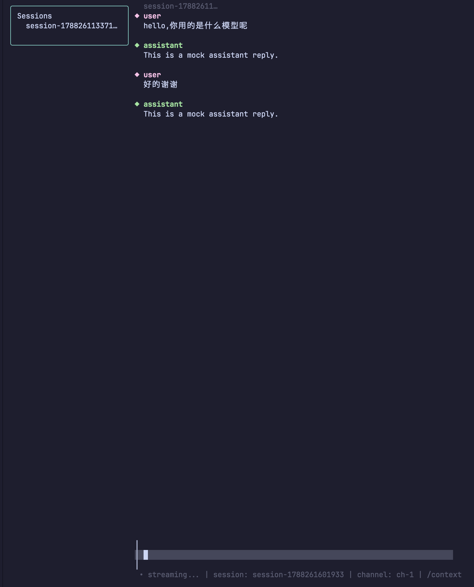

# ⚡ AgentForge

> 跑在终端里的 AI 开发代理：理解项目、执行任务、审 Diff、安全回滚。

[中文](README.md) | [English](README.en.md)


## ✨ 核心亮点

- 🤖 **Agent 主流程**：自然语言 → 计划 → 执行 → Diff → 测试 → 提交/回滚
- 🖥️ **终端 TUI**：Bubble Tea 高性能渲染，多会话 / 分屏 / 命令面板
- 🔌 **MCP 生态**：MCP Client + 权限中心
- 🧠 **Repo Mode**：真正理解你的项目
- 🔐 **安全优先**：加密会话、Keychain、审计、脱敏
- ⚡ **多 Agent**：并行执行 + 依赖树可视化

## 📸 截图



## 🚀 快速开始

```bash
# 安装后先自检环境
agentforge doctor

# 首次运行向导：选择后端并生成/更新本地配置（Mock / DSH Web API / Provider 直连）
agentforge setup

# 生成配置（Provider / API URL / Keychain / 加密会话）
agentforge init --provider deepseek --model deepseek-v4-flash

# 在当前项目生成 AGENT.md 项目上下文
agentforge project-init

# 查看当前配置（密钥自动打码）
agentforge config

# 无后端快速体验
agentforge --mock
```

> DeepSeek Provider 默认使用 `deepseek-v4-flash`，也可选择 `deepseek-v4-pro`、`deepseek-v4-vision` 或 `deepseek-v4-flash-vision-exp`（旧模型 `deepseek-chat` / `deepseek-reasoner` 仍可使用）。

## 文档

- 零基础快速开始： [docs/QUICKSTART.md](docs/QUICKSTART.md)
- 总览： [docs/overview.md](docs/overview.md)
- 完整使用说明： [docs/usage.md](docs/usage.md)
- 更新日志： [CHANGELOG.md](CHANGELOG.md)

## 设计目标

- 以终端 TUI / CLI 为核心交付：Go 单二进制、低内存、高渲染性能。
- 真实接入以 DSH Web API（HTTP + WebSocket）为主；`tui.dsh/v1alpha1` Channel 为实验性/预留协议，不作为官方稳定接入方式。
- 当前聚焦：Agent 主流程、Repo Mode、自然语言执行、Patch-to-PR、Checkpoint 时间线、MCP Client 权限中心、离线队列与项目记忆。

## 项目结构

```text
cmd/agentforge/         入口（TUI / CLI）
cmd/agentforge-smoke    DSH Web API 冒烟/验收工具
internal/dshapi/        真实 DSH Web API 客户端与 Backend 适配
internal/client/        DSH Channel WebSocket 客户端（实验性/预留）
internal/session/       会话状态与本地持久化（含 AsyncStore 异步存储）
internal/agent/         Agent 执行闭环后端：计划、审批、执行、测试、Diff 评审、回滚状态机
internal/contextx/      长会话上下文窗口管理、压缩摘要、Checkpoint/Rewind
internal/mcp/           MCP Client：JSON-RPC 2.0、HTTP/SSE 与 stdio 传输、工具列表/调用
internal/persist/       通用异步持久化队列（Writer）
internal/skill/         Skill 本地安装/仓库克隆/远端 manifest 同步
internal/provider/      直连模型厂商：OpenAI 兼容客户端、代理、路由/故障转移、定价与上下文窗口
internal/offline/       本地 JSON 离线消息队列
internal/security/      AES-GCM 加密、脱敏、审计日志、API Key 安全存储（系统 Keychain / 本地加密文件）
internal/plugin/        插件市场/签名/权限/沙箱
internal/cost/          成本估算与预算管理
internal/executor/      本地 / Docker / SSH 命令执行
internal/orchestrator/  多 Agent 协作与任务编排
internal/memory/        项目记忆 / 语义检索
internal/ui/            Bubble Tea UI
internal/i18n/          轻量国际化语言包（zh / en）
internal/config/        配置与 CLI 参数
internal/telemetry/     可选本地遥测（JSON Lines，脱敏，不联网）
internal/update/        自动更新检查（版本比较 + GitHub Release 查询）
```

## 当前能力

当前核心能力围绕终端 TUI / CLI 客户端：

- **DSH 客户端与真实 API**：`internal/dshapi` 接入 DSH Web API（HTTP RPC + WebSocket 事件流），支持 seq 断点续传、自动重连与真实会话恢复；`internal/client` 保留实验性/预留的 Channel WebSocket 客户端（对应 `tui.dsh/v1alpha1`，非官方稳定协议）。
- **TUI 工作台**：Bubble Tea 聊天界面、流式渲染与虚拟滚动/增量渲染、命令面板、多行输入、`@` 文件引用与自动补全、多会话 Tab/分屏、Context/Cost/Diff/Todo/Tools/Skills/Plugin 面板、会话搜索与历史全文搜索、输入历史搜索（`Ctrl+R`）、会话总览（`/agentview`）、时间回溯（空输入双击 `Esc`）、常驻 HUD（上下文/成本/TPS）、`/clear` 清空当前会话、`/status` 状态摘要、`/compact` 上下文压缩，以及 `/exec` 执行面板。
- **键位自定义**：可通过 `<data-dir>/keybindings.json` 自定义 help/palette/history 等全局键位。
- **Provider 直连**：`internal/provider` 提供 OpenAI 兼容客户端、多 API Key 轮询、路由/故障转移、错误映射、成本单价表与模型上下文窗口注册表；支持 HTTP/HTTPS/SOCKS5 代理与本地离线消息队列。
- **Agent 与上下文工程**：`internal/agent` 提供 Agent 执行闭环/审批状态机；`internal/contextx` 提供长会话上下文窗口管理、压缩摘要与 Checkpoint/Rewind；`internal/mcp` 提供 MCP Client（JSON-RPC 2.0、HTTP/SSE/stdio、工具列表/调用）；`internal/persist` 与 `session.AsyncStore` 提供异步持久化，`Save` 不阻塞 UI；以上能力已接入 UI（Agent 审批面板、`/checkpoint`、`/rewind`、`/mcp`、`/mcp-call`）。
- **多 Agent 与执行**：`internal/orchestrator` 多 Agent 协作与任务编排；`internal/memory` 项目记忆/语义检索；`internal/executor` 统一本地/Docker/SSH 命令执行；`internal/plugin` 插件治理（签名、权限、沙箱、审核）。
- **插件市场 CLI**：`agentforge market search/install/list`，可直接从命令行搜索、安装和列出插件市场条目。
- **doctor 终端诊断与无颜色模式**：`agentforge doctor` 提供终端兼容性诊断；`--no-color` 可关闭颜色/ANSI 输出，便于不支持颜色的终端或管道日志。
- **i18n 国际化**：中/英文界面，`--lang zh|en` 切换，默认中文。
- **本地安全**：AES-GCM 加解密、敏感信息脱敏、审计日志，以及 API Key 系统 Keychain / 本地加密文件存储。
- **遥测与更新**：可选本地遥测（JSON Lines、脱敏、不联网，默认关闭）；自动更新检查（版本比较 + GitHub Release 查询，仅提示不自动下载）。
- **项目上下文**：`agentforge project-init` 可在当前项目生成 `AGENT.md` 项目上下文，供 Agent 与 Repo Mode 理解项目背景、构建/测试约定。
- **会话导入 / 导出**：`export` / `import` 支持本地批量迁移与备份恢复。
- **非交互与远程执行**：`--headless --prompt` 可不启动 TUI 直接调用 Provider/DSH 后端并打印结果，支持 `--format text|json|stream-json`（含流式 JSON Lines）；`exec` 子命令复用 `internal/executor` 支持本地、Docker 容器和 SSH 远程命令执行。
- **发布与安装**：多平台 `make release`、`make package` 生成 CLI 安装包、Windows `scripts/install.ps1`、GitHub Actions CI 与 fuzz。

UI 体验细节：

- 已加载插件的 `Manifest.Commands` 会自动注册进命令面板（`/plugin:<插件名>:<命令>`，无冲突时也可用 `/<命令>`）
- 空聊天欢迎页：新会话没有消息时显示欢迎/引导页，提示如何开始第一条消息或使用命令面板
- 底部上下文快捷键栏：聊天区底部动态提示当前可用操作（如 `Enter 发送`、`Tab 切换焦点`、`? 帮助`），降低新手记忆负担
- 启用鼠标支持：滚轮可滚动聊天 viewport，命令面板/列表面板中滚轮移动光标
- 帮助：`?`（输入框为空时）或 `Ctrl+/` 打开帮助面板，`Esc` 关闭；帮助面板包含“全局快捷键”区块，并支持 `↑/↓` 或 `j/k` 滚动
- 输入历史搜索：`Ctrl+R` 打开输入历史搜索，支持 `↑/↓` 选择、`Enter` 回填、`Esc` 关闭
- 文件引用自动补全：输入 `@` 会触发当前工作区文件路径补全，选择后把 `@<路径>` 插入输入框，便于在消息中引用文件
- 全局键位自定义：可通过 `<data-dir>/keybindings.json` 调整 help/palette/history 等全局键位；未配置项保持默认
- 会话总览：`/agentview` 打开会话总览，展示当前会话、最近会话与运行中的多 Agent 任务
- 时间回溯：空输入时双击 `Esc` 打开时间回溯，可选取用户消息取回编辑并重发
- 常驻 HUD：界面常驻显示上下文 tokens、成本 cost 与生成速度 TPS
- `/clear` 清空当前会话聊天内容，便于重新开始；`/status` 查看当前状态摘要
- MCP 工具审批面板：MCP 工具需要确认时会弹出审批面板，支持 `a` 本次允许、`s` 总是允许、`d` 拒绝本次、`n` 拒绝并记住
- 主题系统：`--theme` 支持 `default` / `catppuccin` / `dracula` / `tokyo-night` / `nord` / `solarized`
- 会话自动命名：新会话会根据第一条用户消息自动生成标题；使用 `/rename` 手动设置的标题不会被后续自动命名/持久化覆盖
- `/sessions` 会话面板支持按工作区分组，面板聚焦后可用 `↑/↓` 移动游标、`Enter` 切换到选中的会话、`n` 新建会话；并新增 `/resume` 作为 `/sessions` 的别名
- Diff Review 面板支持 `A` 全部接受、`R` 全部拒绝
- 面板默认不抢占输入；打开面板后按 `Tab` 在“输入框 / 面板”之间切换焦点，`Esc` 返回输入或关闭面板
- 命令面板默认只展示基础命令，按 `Tab` 可切换为全部命令；支持 `↑/↓`、`Home/End`、`Ctrl+N`
- 多 Agent 面板（`/agents`）支持 `↑/↓` 或 `j/k` 导航
- 本地会话持久化节流为最多每 500ms 写一次，退出前强制落盘
- 状态栏使用 `•` / `⚠` / `✖` 等符号前缀，不只依赖颜色
- 窄屏（宽度 < 80）自动隐藏右侧 Overview 面板和分屏

## 内置命令

在输入框输入以下命令并回车（除 `/image` 外，不会作为普通消息发给 Agent）：

| 命令 | 作用 |
|---|---|
| `/context` | 打开/关闭 Context 用量面板 |
| `/cost` | 打开/关闭成本估算面板 |
| `/diff` | 打开/关闭 Diff Review 面板（真实 API 可解析 `git diff` 输出；`A` 全部接受、`R` 全部拒绝，`p` 生成 patch） |
| `/todos` | 打开/关闭 Todo / 任务计划面板 |
| `/tools` | 打开/关闭工具调用记录面板 |
| `/skills` | 打开/关闭 Skill 管理面板 |
| `/plugin` | 打开/关闭插件列表面板 |
| `/sessions` | 打开/关闭本地/远端会话列表（支持按工作区分组）；面板聚焦后可用 `↑/↓` 移动、`Enter` 切换、`n` 新建 |
| `/resume` | `/sessions` 的别名，用于打开会话列表并恢复/切换会话 |
| `/search <关键词>` | 过滤会话列表 |
| `/find <关键词>` | 全文搜索历史消息 |
| `/right` | 打开/关闭右侧常驻 Overview 面板 |
| `/split` | 打开/关闭双会话并排视图 |
| `/model [模型]` | 查看当前模型；Provider 直连时可切换模型 |
| `/status` | 查看当前状态摘要 |
| `/new` | 新建一个普通会话 |
| `/clear` | 清空当前会话 |
| `/compact` | 压缩当前会话旧消息为摘要，释放上下文空间 |
| `/export` | 导出当前会话为 Markdown/JSON |
| `/rename <标题>` | 手动重命名当前本地会话；该标题不会被后续自动命名覆盖 |
| `/delete` | 删除当前本地会话 |
| `/skill-install <本地目录\|git URL>` | 从本地目录或 git 仓库安装/更新 Skill |
| `/skill-sync <manifest-url>` | 从 JSON manifest 同步远端 Skill 仓库清单 |
| `/agent` | 打开/关闭 Agent 执行/审批面板；`/agent new` 新建会话 |
| `/agent-new` | 新建 Agent 执行会话 |
| `/agent-reset` | 重置 Agent 执行会话 |
| `/checkpoint <名称>` | 保存当前会话 Checkpoint 到时间线 |
| `/rewind <ID\|名称>` | 回滚到指定 Checkpoint 或时间线快照 |
| `/timeline` | 查看 Checkpoint 时间线 |
| `/fork <标签>` | 从当前会话分叉一个新的时间线分支 |
| `/mcp <url>` | 连接 MCP Server 并列出工具 |
| `/mcp-call <工具> <json>` | 调用 MCP 工具 |
| `/mcp-approve` | 批准当前挂起的 MCP 调用 |
| `/mcp-cancel` | 取消当前挂起的 MCP 调用 |
| `/mcp-auto <工具>` | 设置 MCP 工具为自动执行 |
| `/mcp-confirm <工具>` | 设置 MCP 工具为每次确认 |
| `/mcp-deny <工具>` | 禁止 MCP 工具 |
| `/mcp-audit` | 查看最近的 MCP 调用审计 |
| `/remember <键> <值>` | 保存一条项目记忆 |
| `/forget <键>` | 删除一条项目记忆 |
| `/memory [查询]` | 列出或搜索项目记忆 |
| `/exec [命令]` | 打开执行面板，或直接执行命令 |
| `/image <图片路径> [文字...]` | 发送本地图片给支持多模态的模型（如 DeepSeek Vision），Provider 会读取文件并编码为 data URL |
| `/multi <提示词1,提示词2,...>` 或 `/multi [{"id":"a","prompt":"...","deps":["b"]}]` | 准备多 Agent 任务（JSON 形式支持依赖）并打开面板；用 `/multi-run` 执行 |
| `/multi-run` | 执行 `/multi` 已准备的多 Agent 任务 |
| `/agents` | 打开/关闭多 Agent 面板 |
| `/agentview` | 打开会话总览（当前会话、最近会话、运行中的多 Agent 任务） |
| `/help` | 显示可用命令 |
| `/close` | 关闭当前 Channel |

图片输入示例：

```text
/image ~/Desktop/demo.png 请描述这张图片里的内容
/image ~/Desktop/diagram.png
```

> MCP 工具需要确认时会弹出审批面板，支持 `a` 本次允许、`s` 总是允许、`d` 拒绝本次、`n` 拒绝并记住；`Esc` / `q` 可取消本次调用。

如果已加载插件声明了 `commands`，命令面板和输入框还会额外支持这些插件命令，例如 `/plugin:demo:status` 或（无冲突时）`/status`。

## 插件市场 CLI

```bash
# 搜索插件市场中的插件
agentforge market search <关键词>

# 列出插件市场条目
agentforge market list

# 安装指定插件
agentforge market install <插件名>
```

`agentforge market search/install/list` 可直接在命令行操作插件市场：搜索可用插件、查看市场列表，以及安装目标插件到本地插件目录。详细说明见 [docs/usage.md](docs/usage.md)。

## 会话导入 / 导出

不启动 TUI，直接用命令行批量迁移/备份本地会话：

```bash
# 导出全部会话 JSON 到指定目录
agentforge export --out-dir /path/to/export

# 从导出目录导入全部会话（已存在的 ID 会跳过，不覆盖）
agentforge import --in-dir /path/to/export
```

详细说明见 [docs/usage.md](docs/usage.md)。

## 非交互与远程执行

不启动 TUI 的 Headless 对话，以及本地 / 容器 / 远程命令执行：

```bash
# Headless：直接向 Provider/DSH 后端发送 prompt 并打印最终结果
agentforge --headless --provider deepseek --provider-key sk-xxx --prompt "hello"

# Headless：流式 JSON Lines 输出（每行一条 JSON，便于脚本/CI 实时消费）
agentforge --headless --provider deepseek --provider-key sk-xxx --prompt "hello" --format stream-json

# 本地执行
agentforge exec --local --cmd "echo hi"

# Docker 容器执行
agentforge exec --docker --image alpine --cmd "echo hi"

# SSH 远程执行
agentforge exec --ssh --host user@host --cmd "echo hi"

# 指定超时与工作目录
agentforge exec --local --cmd "go test ./..." --workdir /path/to/project --timeout 5m
```

### Agent 主流程 / 多 Agent

Agent 主流程 Demo：自然语言需求 → 计划 → 执行 → Diff → 测试 → 提交/回滚。

> 静态规划器只支持以 `run` / `edit` / `test` 开头的确定性指令；仓库感知或自然语言需求请使用 `--planner llm`（需要 API Key）。

```bash
# 静态规划器：仅支持 run/edit/test 指令
agentforge agent --prompt "run go test ./..." --yes

# 仓库感知 + 自然语言：必须使用 LLM 规划器（需要 API Key）
agentforge agent --prompt "帮我看看这个项目怎么跑" --repo --planner llm --provider deepseek --provider-key sk-xxx --yes

# 使用 LLM 规划器（需要 API Key）
agentforge agent --prompt "帮我加一个 --version 参数" --planner llm --provider deepseek --provider-key sk-xxx --repo --yes

# 自动提交 / 推送 / 创建 PR
agentforge agent --prompt "edit README.md hello" --yes --commit --push --pr --pr-title "docs: update readme"

# 并行执行多个 Agent 任务
agentforge multiagent --tasks "run echo a,run echo b,run echo c" --yes

# JSON 输出（便于脚本/CI 集成）
agentforge agent --prompt "run echo hi" --yes --json
agentforge multiagent --tasks "run echo a,run echo b" --yes --json

# 安全预览：只生成计划，不实际执行
agentforge agent --prompt "add --version to main.go" --planner llm --dry-run
agentforge multiagent --tasks "run echo a,run echo b" --dry-run

# 连接 MCP Server（真实 MCP 验收）
agentforge mcp --url http://127.0.0.1:8000/mcp

# 真实 LLM 验收（需要 API Key）
AGENTFORGE_PROVIDER=deepseek \
AGENTFORGE_PROVIDER_KEY=sk-xxx \
./scripts/acceptance-llm.sh
```

> ⚠️ **安全警告**：`--yes` 会自动批准所有 Agent 动作。与 `--commit`、`--push`、`--pr` 一起使用时，会在没有逐条确认的情况下创建分支/提交、推送到远端并创建 PR。请只在可信仓库或 CI 中使用，并确保工作区已备份或可回滚。

TUI 多 Agent 依赖图/子任务树：

```text
/multi [{"id":"a","prompt":"run echo a"},{"id":"b","prompt":"run echo b","deps":["a"]}]
/multi-run
/agents
```

详细参数说明见 [docs/usage.md](docs/usage.md)。

快捷键：

| 按键 | 作用 |
|---|---|
| `Ctrl+C` | 第一次停止生成，第二次退出 |
| `Ctrl+J` | 输入框内换行（多行输入） |
| `Ctrl+E` | 用 `$EDITOR` 编辑当前输入 |
| `Ctrl+P` | 打开命令面板 / 模糊搜索（默认基础命令，`Tab` 切换全部） |
| `Ctrl+R` | 搜索输入历史 |
| `@` | 触发文件引用与路径自动补全 |
| `/compact` | 压缩当前会话旧消息 |
| `/agentview` | 打开会话总览 |
| `/clear` | 清空当前会话 |
| `/status` | 查看当前状态摘要 |
| 空输入双击 `Esc` | 时间回溯 |
| 常驻 HUD | 显示上下文 tokens / 成本 cost / TPS |
| `?`（输入框为空时）或 `Ctrl+/` | 打开帮助面板 |
| 帮助面板 `↑` / `↓` 或 `j` / `k` | 滚动帮助面板内容 |
| 多 Agent 面板 `↑` / `↓` 或 `j` / `k` | 在多 Agent 任务/子任务列表中导航 |
| 会话面板 `↑` / `↓` | 在会话列表中移动游标 |
| 会话面板 `Enter` | 切换到当前选中的会话 |
| 会话面板 `n` | 新建会话 |
| MCP 审批面板 `a` | 本次允许当前 MCP 调用 |
| MCP 审批面板 `s` | 总是允许该 MCP 工具（自动执行） |
| MCP 审批面板 `d` | 拒绝本次 MCP 调用 |
| MCP 审批面板 `n` | 拒绝并记住（禁止该 MCP 工具） |
| MCP 审批面板 `Esc` / `q` | 取消当前 MCP 调用并关闭面板 |
| 鼠标滚轮 | 滚动聊天消息；命令面板/列表面板中移动光标 |
| `Ctrl+←` | 切换到上一个会话 Tab |
| `Ctrl+→` | 切换到下一个会话 Tab |
| 右侧 Overview 面板内 `1`~`4` | 打开 Context / Cost / Diff / Todos 详情面板 |
| 双会话并排内 `[` / `]` | 切换右侧会话 |
| 双会话并排内 `s` | 切换到右侧会话并发送消息 |
| Diff 面板内 `j` / `k` | 上/下移动 Diff 光标 |
| Diff 面板内 `a` / `r` | 接受 / 拒绝当前 Diff |
| Diff 面板内 `A` / `R` | 全部接受 / 全部拒绝所有 Diff |
| Diff 面板内 `p` | 把已接受的 Diff 保存为 patch 文件 |
| Diff 面板内 `g` | 两次 `g` 确认后执行 `git apply` 应用到工作区 |

## 开发

```bash
# 使用内置 mock server 启动（无需真实 DSH）
go run ./cmd/agentforge --mock

# 推荐：连接真实 DSH Web API（HTTP + WebSocket，当前已实测）
go run ./cmd/agentforge --api-url http://127.0.0.1:54695

# 实验性/预留：DSH TUI Channel（tui.dsh/v1alpha1，非官方稳定协议；接入真实 DSH 请使用上方 DSH Web API）
go run ./cmd/agentforge --endpoint ws://127.0.0.1:18891/agentforge/v1/connection

# 恢复会话
go run ./cmd/agentforge --mock --resume session-xxx

# 设置成本告警阈值（元）
go run ./cmd/agentforge --mock --cost-limit 5

# 使用主题：default / catppuccin / dracula / tokyo-night / nord / solarized
go run ./cmd/agentforge --mock --theme catppuccin
# 例如：go run ./cmd/agentforge --mock --theme dracula

# 使用英文界面（默认中文）
go run ./cmd/agentforge --mock --lang en

# 关闭颜色/ANSI 输出（适合不支持颜色的终端或管道日志）
go run ./cmd/agentforge --mock --no-color

# 启用本地遥测（默认关闭；仅写本地 telemetry.log，不联网）
go run ./cmd/agentforge --mock --telemetry
# 或通过环境变量开启
DSH_TELEMETRY=1 go run ./cmd/agentforge --mock

# 远程直连（HTTPS/WSS + Token）
go run ./cmd/agentforge --remote --api-url https://dsh.example.com --api-token <token>

# 通过 SSH 隧道连接远程 DSH（本地仍为 loopback）
# 先执行: ssh -L 18891:127.0.0.1:18891 user@dsh-host
go run ./cmd/agentforge --api-url http://127.0.0.1:18891 --api-token <token>
```

## 远程部署与 Token

DSH Web API 默认监听本机 loopback。远程访问有两种推荐方式：

- **SSH 隧道**：在本地把远程端口映射到 `127.0.0.1`，URL 保持 loopback，无需额外 TLS；仍建议使用 `--api-token` 做服务端认证。
- **HTTPS/WSS 直连**：通过反向代理暴露 `https://dsh.example.com` 后，使用 `--remote --api-url https://dsh.example.com --api-token <token>` 直连。

客户端会在 dshapi 的 HTTP POST 与 WebSocket 握手请求中自动附加 `Authorization: Bearer <token>`。当 `--remote` 且远程地址不是 loopback 也不是 `https`/`wss` 时，会打印安全警告。

详细说明见 [docs/usage.md](docs/usage.md)。

## API Key 安全存储

Provider 直连模式下，API Key 除了放在 `--provider-key` 命令行中外，也可以保存到系统 Keychain / 凭据管理器：

```bash
# 首次保存 key 到 macOS Keychain / Windows Credential Manager / Linux secret-tool
go run ./cmd/agentforge --provider deepseek --provider-key sk-xxx --keychain

# 之后启动不再需要 --provider-key
go run ./cmd/agentforge --provider deepseek --keychain
```

- macOS 调用 `security`；Windows 调用 PowerShell + Credential Manager；Linux 需要安装 `secret-tool`（libsecret），未安装时会返回明确的“不支持”错误。
- 交互式终端下，macOS Keychain 保存会优先使用 `security -w` 的安全提示模式，避免密钥出现在进程命令行；非交互场景仍会回退到参数传递，建议在可信的单用户机器上使用。
- 不想让 API Key 出现在 Shell 历史/命令行中时，可以用 stdin 传入：
  ```bash
  echo "$DEEPSEEK_API_KEY" | agentforge --provider deepseek --provider-key-stdin --keychain
  ```
- 不想使用系统 Keychain 时，也可以把 Key 加密保存到本地文件 `<data-dir>/secrets.json`，主密钥来自 `--secret-key` 或环境变量 `DSH_SECRET_KEY`：

```bash
export DSH_SECRET_KEY=$(openssl rand -hex 32)
go run ./cmd/agentforge --provider deepseek --provider-key sk-xxx --secret-key "$DSH_SECRET_KEY"
go run ./cmd/agentforge --provider deepseek --secret-key "$DSH_SECRET_KEY"
```

## 可选加密会话存储

默认本地会话以明文 JSON 保存在 `<data-dir>/sessions/`。如需加密落盘：

```bash
export DSH_SECRET_KEY=$(openssl rand -hex 32)

# 启动时启用加密会话存储
go run ./cmd/agentforge --encrypt-sessions --secret-key "$DSH_SECRET_KEY"
# 或使用环境变量
DSH_SECRET_KEY="$DSH_SECRET_KEY" agentforge --encrypt-sessions
```

启用后会话写入 `<id>.json.enc`（AES-GCM），并自动清理同名旧明文文件。

## 可选遥测与自动更新检查

- 遥测默认关闭。通过 `--telemetry` 或 `DSH_TELEMETRY=1` 开启后，事件以 JSON Lines 写入 `<data-dir>/telemetry.log`，字段写入前会脱敏；不联网、不收集敏感信息。
- 自动更新检查目前提供 `internal/update` 的版本比较与 GitHub Latest Release 查询能力，只提示不自动下载；后续可接入启动时提示。

## 模型直连代理与离线队列

直连模型厂商的 `internal/provider` 支持 HTTP/SOCKS 代理，并提供本地 JSON 离线消息队列。

### 代理

- 在 `OpenAIConfig.ProxyURL` 中显式指定代理，支持 `http://`、`https://`、`socks5://` 与 `socks5h://`。
- 未指定 `ProxyURL` 时，自动读取 `HTTPS_PROXY`、`HTTP_PROXY`、`NO_PROXY` 环境变量。

```go
p := provider.NewOpenAI(provider.OpenAIConfig{
    BaseURL:  "https://api.openai.com/v1",
    APIKey:   "your-api-key",
    Model:    "gpt-4o-mini",
    ProxyURL: "http://127.0.0.1:7890",
})
```

### 离线队列

`internal/offline.Queue` 基于本地 JSON 文件暂存待发送消息：

```go
q := offline.NewQueue("/path/to/data-dir/offline.json")

_ = q.Enqueue("session-id", "用户消息")
items, _ := q.Pending()
_ = q.Remove(items[0].ID)
```

## 真实 DSH API 验证工具

```bash
# 先启动 DSH Web（任意空闲端口）
dsh --profile web --no-open --port 0

# 然后用 smoke 工具连接并发送 prompt
go run ./cmd/agentforge-smoke --url http://127.0.0.1:<port> --prompt "你好" --watch 8s
```

## 测试

```bash
go test ./...
go test -race ./internal/client ./internal/mock
make fuzz
```

## 安装

### 从发布包安装

从 GitHub Releases 下载对应平台的安装包：

- **macOS**：下载 `agentforge-darwin-<arch>.dmg`（若 Release 仅提供 `.zip`，则解压后使用）。打开 DMG 后将 `agentforge` 复制到 `/usr/local/bin` 或 `~/bin`：

  ```bash
  sudo cp /Volumes/agentforge-darwin-<arch>/agentforge /usr/local/bin/
  ```

- **Linux**：下载 `agentforge-linux-<arch>.tar.gz`：

  ```bash
  tar -xzf agentforge-linux-<arch>.tar.gz
  sudo install -m 0755 agentforge-linux-<arch>/agentforge /usr/local/bin/
  ```

- **Windows**：下载 `agentforge-windows-<arch>.zip`，解压后运行 `agentforge-windows-<arch>\agentforge.exe`；也可以把该目录加入 PATH。

### 从源码安装

```bash
# 方式一：安装到 ~/.local/bin
make install-local
# 或 PREFIX=/usr/local make install-local

# 方式二：Go 安装
make install

# Windows：构建/下载到 %LOCALAPPDATA%\agentforge\bin
powershell -ExecutionPolicy Bypass -File scripts\install.ps1
# 指定版本并加入用户 PATH
powershell -ExecutionPolicy Bypass -File scripts\install.ps1 -Version 0.3.0 -AddToPath
```

### 环境自检

安装后可以先运行：

```bash
agentforge doctor
```

它会检查 Go、DSH CLI、Git、GitHub CLI、系统 Keychain 后端、数据目录权限和终端兼容性，帮助你快速定位环境问题；发现问题时会输出 `Suggested fixes`，给出可直接执行的建议修复项。若终端不支持颜色或需要管道输出，可加 `--no-color` 关闭颜色。

## 发布构建

```bash
# 1. 构建多平台二进制到 dist/
make release

# 2. 打包到 dist/packages/
#    - Linux:   agentforge-linux-<arch>.tar.gz
#    - macOS:   agentforge-darwin-<arch>.dmg（无 hdiutil 时回退 .zip）
#    - Windows: agentforge-windows-<arch>.zip
make package

# 也可以一步完成：
make release && make package
```

产物位于 `dist/`（二进制）与 `dist/packages/`（安装包）。

## 依赖

- [Bubble Tea](https://github.com/charmbracelet/bubbletea)
- [Lip Glow](https://github.com/charmbracelet/lipgloss)
- [Bubbles](https://github.com/charmbracelet/bubbles)
- [coder/websocket](https://github.com/coder/websocket)

## 说明

本项目为个人项目，主要用于个人学习与日常使用。
